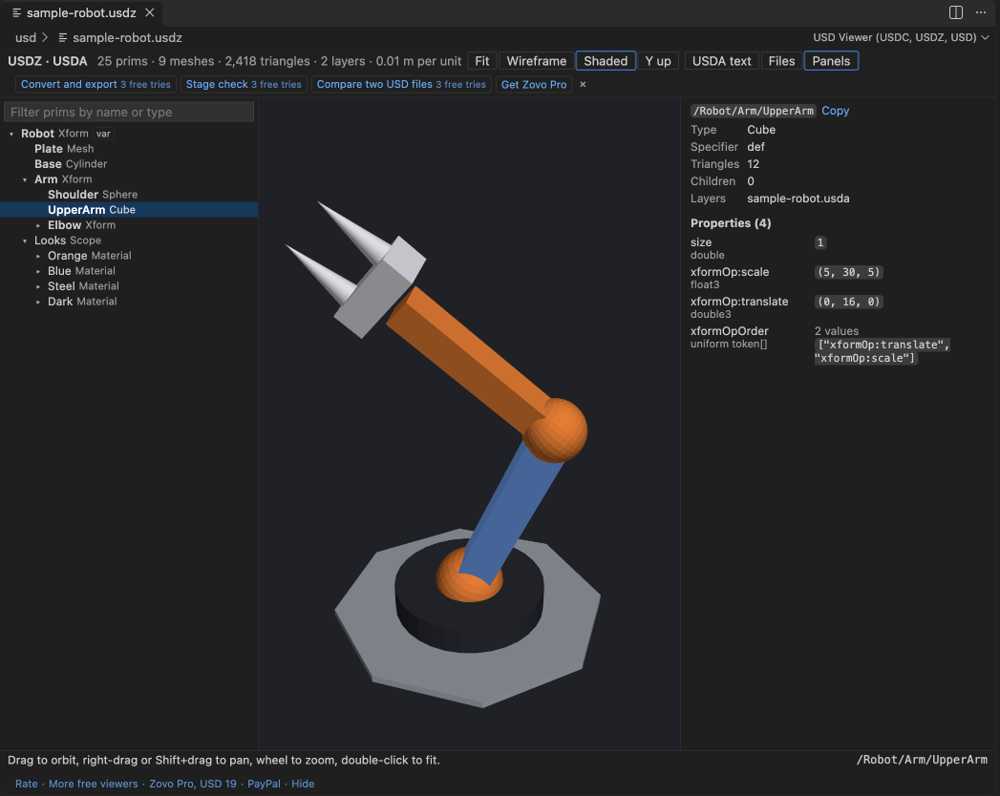

# USD Viewer for USDA, USDC and USDZ

Open Pixar USD files in VS Code. Click a `.usdc`, `.usdz` or `.usd` file and see its prim tree, the attributes of each prim and a 3D view of the meshes, with binary USDC layers shown as readable USDA text. Works offline, with no account and nothing to install. Made by Zovo.

Free, with no time limit:

- A prim tree with types, references, variants and inactive prims marked, and a filter box.
- The details of the picked prim: metadata, attributes with their values, relationships, references, payloads and variant sets.
- USDC binary shown as USDA text in a read-only tab, in the same layout the USD command line tools write.
- A 3D view of meshes, the simple shapes and point instancers: orbit, pan, zoom, wireframe, and the picked prim in blue.
- Sublayers, references, payloads, inherits and the selected variants are followed, on disk and inside USDZ packages. A USDZ package also lists the files inside it, with size and alignment.
- Syntax colors for `.usda` files.

Zovo Pro: USD 19 once, for the Pro tools in every Zovo extension (team of 5: USD 59). Each Pro tool has 3 free tries on your computer first:

- Convert and export: USDC and USDZ to USDA text, USDA to USDC binary, the composed stage as one flat USDA file, meshes as OBJ or glTF binary (GLB).
- Stage check: missing layers, references and textures, broken meshes, missing defaultPrim, upAxis and units, USDZ packaging problems, saved as Markdown or JSON.
- Compare two USD files: two files as prim trees, with prims added and removed and every changed value.

## How to use it

- `.usdc`, `.usdz` and `.usd` files open in the viewer when you click them.
- `.usda` files open as text, with syntax colors. Click the preview button in the editor title, or run USD Viewer: Open in USD Viewer, to see the same file in the viewer.
- In the 3D view: drag to orbit, right-drag or Shift+drag to pan, use the wheel to zoom, double-click or press F to fit. W shows polygon edges, S hides the shaded surfaces.
- Click a prim in the tree to highlight it and list its attributes. Double-click a prim to frame it.
- USDA text in the toolbar opens the layer as text. In a USDZ package, Files lists what is inside, and each USD layer in it has its own text view.
- The Pro tools are in the Command Palette (USD Viewer: ... (Pro)), in the Explorer right-click menu and in the small row under the viewer toolbar. The row closes with its x for the rest of the session, and the setting `usdViewer.showProTools` hides it for good.
- Run USD Viewer: Open the Sample Scene (USDA) from the Command Palette to try it on a small scene.

## What it reads

| Format | Read | Notes |
|---|---|---|
| USDA text | yes | `#usda 1.0` layers, all value types, list ops, variant sets, time samples |
| USDC binary | yes | crate 0.8.0, the version current USD tools write, is tested; other 0.x versions use the same reader |
| USDZ | yes | the root layer and every layer inside; stored entries, deflated ones too |
| `.usd` | yes | text or binary, the file header decides |

The 3D view shows the stage at its start time code. It draws each face with the color of its `displayColor` or of the diffuse color of its bound UsdPreviewSurface material. Textures are not drawn; textured surfaces show in light gray.

## Settings

| Setting | Default | What it does |
|---|---|---|
| `usdViewer.maxFileSizeMB` | 512 | Larger files open with a message instead of the stage |
| `usdViewer.followReferences` | true | Open the sublayers, references and payloads a file names |
| `usdViewer.maxTriangles` | 3,000,000 | Most triangles the 3D view draws |
| `usdViewer.textMaxArray` | 20,000 | Arrays longer than this are shortened in the text view (the converter writes all values) |
| `usdViewer.showProTools` | true | Show the Zovo Pro tools in menus and the toolbar |
| `usdViewer.showSupportLinks` | true | Show the small links at the bottom of the viewer |
| `usdViewer.askForRating` | true | Ask once for a rating, after two good opens at least 30 minutes apart |

## Privacy

No network calls, no telemetry. The viewer reads the file you open and the files it references, from disk or from inside the USDZ package. Nothing is uploaded. The viewer page has a content security policy that blocks every remote load.

## Known limits

- Composition covers sublayers, references, payloads, inherits, specializes and variant selections. Layer offsets, relocates, value clips and list edits across layers are not applied.
- Layers in other file formats (`.mtlx`, `.abc`, `.obj` through USD plug-ins) are listed as not opened.
- Curves, points, NURBS and volumes are listed in the tree but not drawn. Skinned meshes show their rest pose.
- Paths that need a custom asset resolver (URLs, `omniverse://`) are not opened.

Made by Zovo. Free and paid Zovo extensions: [marketplace.visualstudio.com/publishers/zovo](https://marketplace.visualstudio.com/publishers/zovo).
